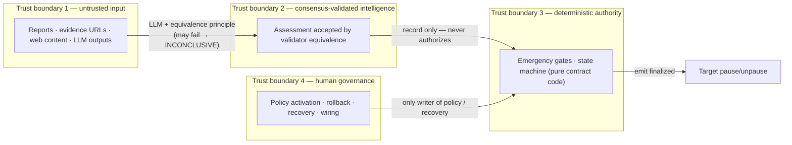
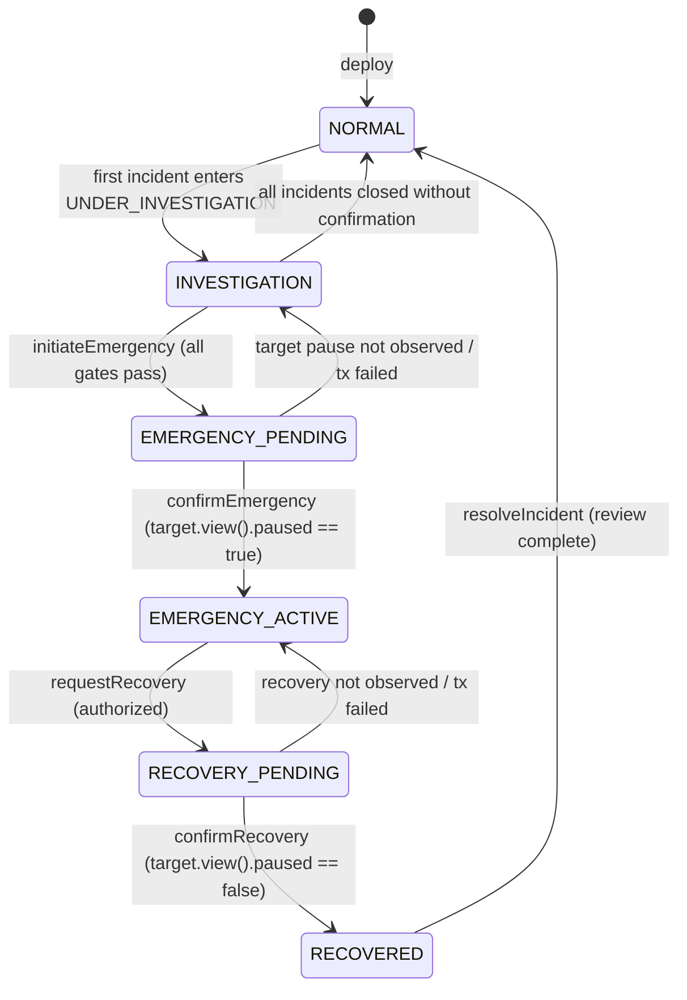
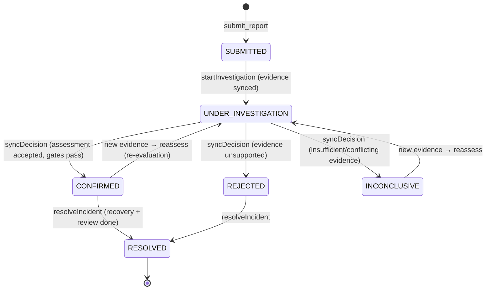
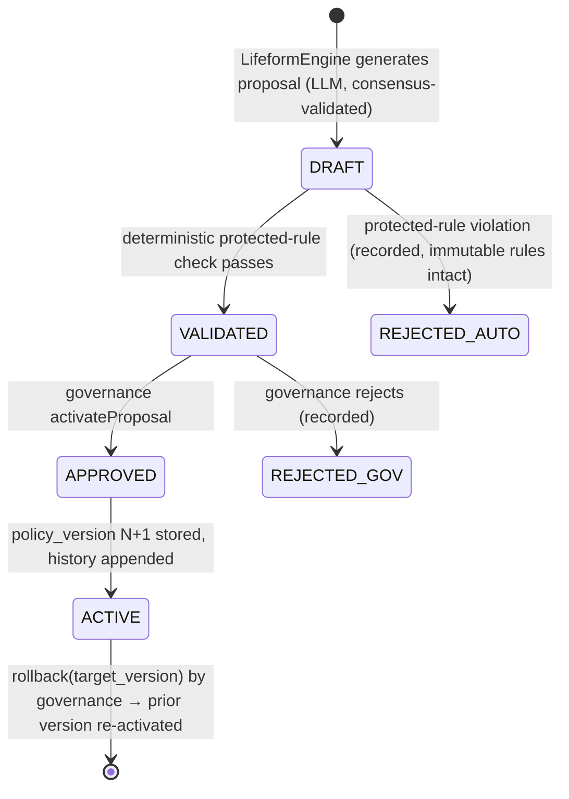

# GENESIS GUARDIAN — System Architecture

**Phase:** 1 — Architecture & Feasibility · **Status:** Approved design for Phase 2 MVP
**Philosophy:** *AI investigates. Validators evaluate. Smart contracts enforce. Governance controls evolution.*

> **Phase 2 implementation deviation (2026-11-03):** the five Phase-2 contracts in the
> diagram below (POL · REG · ANA · GUARD + TGT) are implemented as **one contract
> `GenesisGuardian`** with four feature areas (POLICY / INCIDENT INTELLIGENCE /
> EMERGENCY AUTHORITY / PROTECTED STATE); LifeformEngine remains Phase 3. Concretely:
> the dotted cross-contract `view()` arrows become internal reads, and the
> `emit(on='finalized')` pause/unpause child-tx is replaced by a **two-phase flow** —
> `initiateEmergency` (gates → EMERGENCY_PENDING, no pause) → keeper waits FINALIZED →
> `confirmEmergency` (EMERGENCY_ACTIVE + in-contract `paused=True`); recovery mirrors it
> (`requestRecovery` → `confirmRecovery`). Rationale and full consequences:
> CONTRACT_DESIGN.md "Phase 2 implementation deviation". The diagram and §2 below remain
> the as-designed reference for the Phase 3/4 external-integration target.

---

## 1. High-Level Architecture

```mermaid
flowchart TB
    subgraph OFFCHAIN["Off-chain services (ordinary, permissionless)"]
        REP["Reporter / monitoring agent<br/>(user, bot, security system)"]
        KEEPER["Guardian Keeper<br/>drives deterministic steps,<br/>waits for FINALIZED"]
        DASH["Dashboard (Phase 3)<br/>read-only RPC views"]
    end

    subgraph GL["GenLayer — Intelligent Contracts (consensus-enforced)"]
        direction TB
        POL["SecurityPolicyManager<br/>versioned policy store<br/>(governance writes, others view)"]
        REG["IncidentRegistry<br/>reports · evidence · lifecycle · history"]
        ANA["ThreatAnalyzer<br/>evidence verification + LLM assessment<br/>Equivalence Principle: custom validator"]
        GUARD["GenesisGuardian<br/>emergency state machine +<br/>deterministic activation gates"]
        LIFE["LifeformEngine (Phase 3)<br/>proposal generation (LLM) +<br/>protected-rule validation"]
    end

    subgraph TARGET["Controlled target"]
        TGT["PauseableTarget<br/>pause()/unpause()<br/>guardian-role authorization"]
    end

    EXT["External data (UNTRUSTED)<br/>block explorers · JSON-RPC ·<br/>security feeds · web sources"]

    REP -->|"submit_report (write tx)"| REG
    KEEPER -->|"sync steps: startInvestigation ·<br/>syncDecision · confirmEmergency ·<br/>resolveIncident (permissionless writes)"| REG
    KEEPER -->|"assess(incident_id) · reassess"| ANA
    KEEPER -->|"initiateEmergency(incident_id)"| GUARD
    KEEPER -->|"proposeEvolution(incident_id) (Phase 3)"| LIFE

    ANA -. "view(): report + evidence snapshot"| REG
    ANA -. "view(): evidence requirements"| POL
    GUARD -. "view(): incident status + history"| REG
    GUARD -. "view(): assessment record"| ANA
    GUARD -. "view(): thresholds / allowed actions"| POL
    LIFE -. "view(): incident + assessment + policy"| REG
    LIFE -. "view()"| ANA
    LIFE -. "view()"| POL

    GUARD -->|"emit(on='finalized')<br/>pause()/unpause() — idempotent"| TGT
    TGT -. "view(): paused state for<br/>confirmEmergency/confirmRecovery"| GUARD

    ANA -->|"nondet: HTTP/JSON-RPC fetch +<br/>LLM extraction (equivalence-validated)"| EXT
    LIFE -->|"nondet: LLM proposal generation"| EXT

    DASH -. "read-only calls"| GL
    DASH -. "read-only calls"| TGT

    GOV["Governance (multisig recommended)<br/>policy activation · rollback ·<br/>recovery authorization · wiring"]
    GOV -->|"write: activatePolicy · rollback ·<br/>setRecoveryAuth (Phase 3: approveProposal)"| POL
    GOV -->|"write: requestRecovery ·<br/>linkAnalyzer · setWiring"| REG
    GOV -->|"write: requestRecovery"| GUARD
```

**Legend:** solid arrow = state-changing transaction · dotted arrow = synchronous `view()` read ·
`emit(on='finalized')` = asynchronous child transaction executed only after finality.

---

## 2. Component Placement Decision

The nine suggested logical components map onto **five (Phase 2) + one (Phase 3) Intelligent
Contracts**, one controlled target contract, and ordinary off-chain services:

| Suggested component | Placement | Why |
|---|---|---|
| GenesisGuardianCore | **IC `GenesisGuardian`** | Emergency authority isolated from untrusted input & AI code; holds the state machine and gates |
| SecurityReporting | **IC `IncidentRegistry`** (module) | Record-keeping for reports is deterministic; splitting it into its own contract would add async emits without a security gain. Anyone-writes data never lives in the authority contract |
| EvidenceRegistry | **IC `IncidentRegistry`** (module) | Same rationale; evidence is read by analyzer/guardian via `view()` |
| ThreatAssessment | **IC `ThreatAnalyzer`** | The only LLM-heavy component; its own equivalence logic and consensus cost, auditable in isolation |
| EmergencyController | **IC `GenesisGuardian`** (module) | Must atomically read policy + assessment + incident state; lives with the state machine |
| IncidentRegistry | **IC `IncidentRegistry`** (module) | See above |
| LifeformEngine | **IC `LifeformEngine`** (Phase 3) | LLM proposal generation separated from policy store; proposals never hold write rights |
| PolicyManager | **IC `SecurityPolicyManager`** | Least privilege: analyzer & guardian only `view()` policy; only governance writes |
| GovernanceController | **IC methods + governance address** (in PolicyManager / Guardian / Registry) | Roles are per-contract `Address` checks; no separate contract needed for MVP |
| Target integration | **IC `PauseableTarget`** | EVM external pause is not functional in Studio (verified); a GenLayer-native target with an explicit guardian role is the honest MVP integration |
| Orchestration | **Off-chain keeper** (labeled off-chain) | No on-chain scheduler exists; entry points are permissionless so anyone can run it |
| Dashboard | **Off-chain web app** (Phase 3) | Reads state over RPC; never part of trust path |

**Rejected alternative — one monolithic contract:** would couple untrusted report ingestion,
LLM consensus, emergency authority, and policy in one bytecode unit; a bug in any module
endangers all; and it prevents independent consensus scoping (only the analysis tx pays LLM
time-units). **Rejected alternative — nine separate contracts:** each workflow step would need
`emit()` (async, ≤6x duplication) instead of deterministic in-tx logic, multiplying consensus
rounds and idempotency hazards for no security benefit. The chosen split isolates the three
things that must never trust each other: **input**, **intelligence**, **authority**.

---

## 3. Trust Boundaries



Rules that hold across all boundaries:

1. Nothing in T1 can reach T3 except as **fields of a consensus-accepted assessment**, and even
   then every activation condition is re-checked deterministically in contract code.
2. T2 can only *recommend*; it cannot write policy (T4) or bypass gates (T3).
3. T4 never bypasses gates either — governance authorizes *recovery* and *policy*, not raw halts.
4. The AI is never an upgrader of code, never a policy writer, never a role grantor.

---

## 4. State Machines

### 4.1 Protocol / emergency state (GenesisGuardian, global)



Guards (all deterministic contract checks — see `CONTRACT_DESIGN.md` §5):
- `initiateEmergency` requires: incident CONFIRMED · assessment FINALIZED-and-recorded ·
  threat/confidence/corroboration ≥ policy · no contradiction flag · cooldown elapsed ·
  state ∈ {NORMAL, INVESTIGATION} · policy allows automatic action for the category ·
  target reports the action supported.
- `requestRecovery` requires: state ∈ {EMERGENCY_ACTIVE} · governance authorization
  (or a policy-defined automatic recovery condition in a later phase).
- No transition into EMERGENCY_* is reachable from report submission alone.

### 4.2 Incident lifecycle (IncidentRegistry, per incident)



- A report **never** auto-triggers anything; `SUBMITTED` is inert until a keeper (or anyone)
  starts investigation after evidence collection.
- Reassessment creates `assessment_seq + 1`; the newest accepted assessment supersedes.

### 4.3 Policy evolution (Phase 3, PolicyManager + LifeformEngine)



---

## 5. Core Design Decisions

| # | Decision | Rationale (verified GenLayer facts) |
|---|---|---|
| D1 | **The assessment write transaction IS the decentralized decision** | Optimistic Democracy: leader proposes the assessment receipt, committee verifies it under the contract's Equivalence Principle; Accepted = decision, Undetermined = no state change |
| D2 | **Custom validator (`run_nondet_unsafe`) for analysis** | Leader and validator independently rerun the analysis and compare decision fields (category, level, confidence bucket, recommended action, conflict flag). Leader-output-only checks are explicitly *not consensus* per docs |
| D3 | **Finality gating before any emergency** | Accepted is provisional and appealable; "applications that need irreversible settlement should wait for Finalized". Keeper waits for FINALIZED, *and* the pause is additionally `emit(on='finalized')` |
| D4 | **Idempotent cross-contract receivers** | Docs: accepted-state messages can re-emit up to ~6× across appeal rounds; every receiver (pause/unpause/record/sync) is a keyed no-op when already in the target state |
| D5 | **Deterministic gates override AI** | Emergency conditions are contract code over stored fields; LLM output is an argument to the gates, never the gates themselves |
| D6 | **Policy in a separate contract, `view()`-only for AI/authority paths** | Least privilege; governance is the sole writer; version history lives with the data |
| D7 | **Frozen code (no upgraders) in v1** | `lock_default()` at deploy + empty upgraders list = bytecode immutable; evolution happens in versioned data; AI can never alter source |
| D8 | **Permissionless deterministic entry points + off-chain keeper** | No on-chain scheduler exists; keeper compromise cannot violate any gate; anyone may run the keeper (documented as off-chain, not autonomous on-chain) |
| D9 | **GenLayer-native pause target for MVP** | `@gl.evm.contract_interface` not functional in Studio (verified); external-EVM pause is an open question deferred to Phase 4 |
| D10 | **Evidence taxonomy enforced by type field** | ONCHAIN_VERIFIED / EXTERNAL / USER_CLAIM / AI_INTERPRETATION — only the first three can count toward corroboration; AI interpretations are stored separately and never counted as source evidence |
| D11 | **INCONCLUSIVE is a safe outcome** | Insufficient, contradictory, or failed evidence/LLM paths resolve to INCONCLUSIVE (fail-closed), never to a halt |
| D12 | **Timestamps from `gl.message_raw.datetime`** | The only documented clock (transaction time, identical across validators); no wall-clock/block-number assumptions |

---

## 6. Deployment & Wiring Order (Phase 2)

Contracts reference each other by address; circular dependencies are resolved with
one-time, governance-controlled wiring setters (documented in `CONTRACT_DESIGN.md`):

1. `PauseableTarget(owner)` — guardian role initially unset
2. `SecurityPolicyManager(governance, bootstrap_policy)` — no dependencies
3. `IncidentRegistry(governance)` — no dependencies
4. `ThreatAnalyzer(registry, policy)` — depends on 2, 3
5. `GenesisGuardian(registry, analyzer, policy, target, governance)` — depends on 2–5
6. Wiring: `registry.linkAnalyzer(analyzer)` · `target.setGuardian(guardian)` (governance, one-time)
7. Verify: `genvm-lint check` all contracts → direct-mode tests → deploy → smoke `call()`s

---

## 7. What Each Layer Decides (summary — full text in GENLAYER_INTEGRATION.md §4)

- **Intelligent Contract decides:** schema validity, deterministic gate evaluation, state
  transitions, what evidence counts, which policy version applies.
- **Validators check:** that the leader's nondeterministic analysis reproduces under the
  Equivalence Principle (independent rerun + decision-field comparison), and that deterministic
  execution matches exactly.
- **Accepted decision:** committee majority → receipt Accepted → recorded → (after FINALIZED) usable by gates.
- **Validators disagree:** rotation → retry; possibly **Undetermined** → no state change →
  keeper observes and retries/appeals. No emergency can occur without an accepted assessment.
- **Evidence changes:** a new assessment (`seq+1`) supersedes; if an emergency is active, changed
  evidence feeds re-evaluation/recovery — never an automatic unguarded action.
- **Appeal:** anyone can appeal during the window (bond+funding); fresh committee re-evaluates.
- **Emergency permitted only when:** every deterministic gate in §4.1 passes *and* the target
  contract's own authorization accepts the call.
