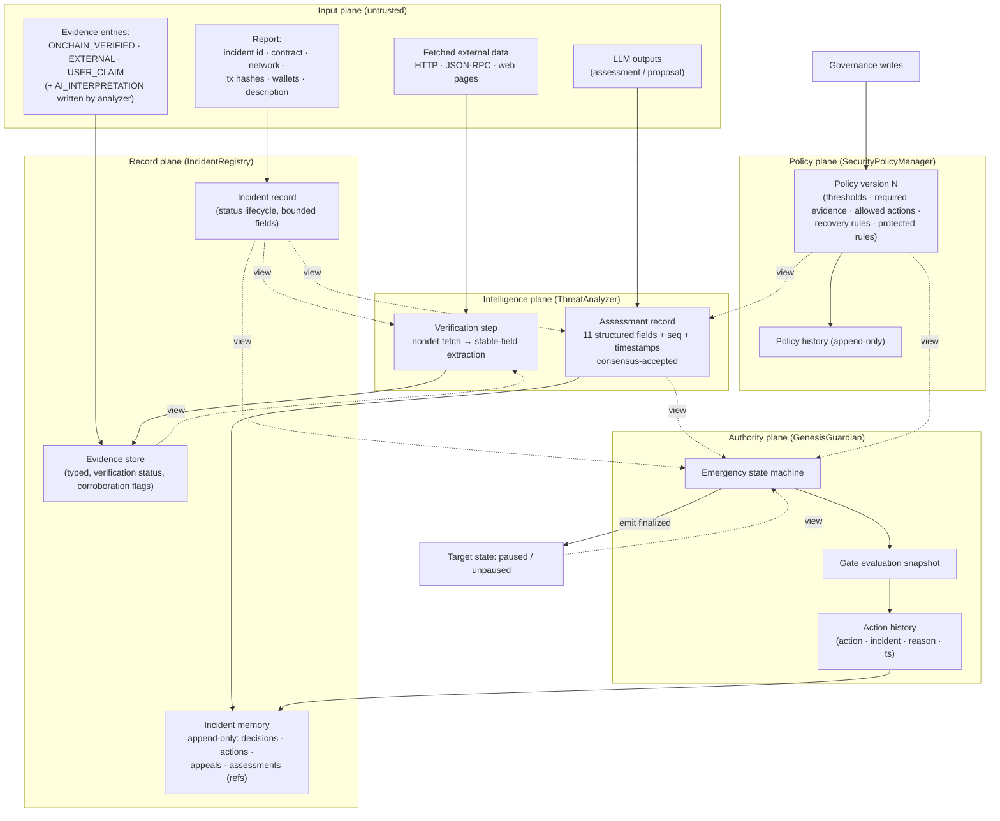

# GENESIS GUARDIAN — Data Flow

**Phase:** 1 — Architecture & Feasibility · **Deliverable 4**

---

## 1. End-to-End Flow (report → emergency → recovery)

```mermaid
sequenceDiagram
    autonumber
    participant R as Reporter / Keeper
    participant REG as IncidentRegistry (IC)
    participant ANA as ThreatAnalyzer (IC)
    participant POL as SecurityPolicyManager (IC)
    participant G as GenesisGuardian (IC)
    participant T as PauseableTarget (IC)
    participant EXT as External web/RPC (untrusted)

    Note over R,EXT: PHASE 1 — intake & evidence
    R->>REG: submit_report(tx_hashes, wallets, desc, evidence_refs)<br/>tx1 (write) — status SUBMITTED
    R->>REG: append_evidence(typed entries)<br/>tx2 — USER_CLAIM / EXTERNAL
    R->>REG: startInvestigation(incident_id)<br/>tx3 (permissionless) — UNDER_INVESTIGATION

    Note over R,EXT: PHASE 2 — verification + LLM analysis (consensus)
    R->>ANA: assess(incident_id)<br/>tx4 (write)
    ANA->>REG: view(): report + evidence snapshot (sync, pre-nondet)
    ANA->>POL: view(): evidence requirements (sync)
    ANA->>EXT: nondet: HTTP/JSON-RPC fetch + exec_prompt (leader)
    Note over ANA: Leader proposes receipt;<br/>committee validators RERUN analysis (Equivalence Principle:<br/>run_nondet_unsafe, compare decision fields)
    alt majority agrees
        ANA->>ANA: Accepted → assessment stored (seq=1)<br/>provisional until FINALIZED
    else disagreement / rotation exhausted
        ANA->>ANA: Undetermined → NO state change → INCONCLUSIVE path
    end

    Note over R,EXT: PHASE 3 — decision recording (finality-gated)
    R->>ANA: (off-chain) wait until tx4 == FINALIZED
    R->>REG: syncDecision(incident_id)<br/>tx5 (permissionless, deterministic)<br/>reads analyzer + policy → CONFIRMED/REJECTED/INCONCLUSIVE

    Note over R,EXT: PHASE 4 — emergency
    R->>G: initiateEmergency(incident_id)<br/>tx6 (permissionless, all gates evaluated in code)
    G->>REG: view(): status == CONFIRMED
    G->>ANA: view(): assessment (seq, threat, confidence, conflict)
    G->>POL: view(): thresholds, allowed actions, cooldown
    alt all gates pass
        G->>G: state NORMAL/INVESTIGATION → EMERGENCY_PENDING<br/>history entry (gates snapshot)
        G->>T: emit(on='finalized').pause()<br/>child tx (only after tx6 finalized; re-emitted ≤~6x → idempotent)
        T->>T: sender == guardian? pause() (no-op if paused)
        R->>G: confirmEmergency(incident_id)<br/>tx7 — G view()s T.paused == true → EMERGENCY_ACTIVE
    else any gate fails
        G->>G: UserError [EXPECTED] → no state change
    end

    Note over R,EXT: PHASE 5 — recovery (governance-authorized)
    participant GOV as Governance
    GOV->>G: requestRecovery(incident_id, reason)<br/>tx8 — → RECOVERY_PENDING
    G->>T: emit(on='finalized').unpause() (idempotent)
    R->>G: confirmRecovery(incident_id)<br/>tx9 — T.paused == false → RECOVERED
    GOV->>REG: resolveIncident(incident_id, outcome)<br/>tx10 → RESOLVED (false_positive flag if evidence overturned)
```

---

## 2. Data-Flow Diagram (structural — what data moves where)



---

## 3. Mapping to the 12-Step End-to-End Workflow

| Step | Workflow element | Data flow | On-chain? |
|---|---|---|---|
| 1 | Security report received | Report → `IncidentRegistry` (`SUBMITTED`) | ✅ write tx |
| 2 | Evidence collected | Typed entries → evidence store; analyzer fetches/verifies externally | ✅ + nondet fetch |
| 3 | Intelligent threat analysis | Report+evidence snapshot → LLM (nondet) → candidate assessment | ✅ nondet in tx |
| 4 | GenLayer decentralized validation | Leader receipt vs validator reruns under Equivalence Principle → Accepted / Undetermined | ✅ consensus |
| 5 | Decision status recorded | FINALIZED assessment → `syncDecision` → CONFIRMED/REJECTED/INCONCLUSIVE | ✅ write tx |
| 6 | Automatic emergency condition | `initiateEmergency` evaluates gates from registry/analyzer/policy views | ✅ deterministic |
| 7 | Emergency halt initiated | `emit(on='finalized')` pause → target `paused=true` | ✅ async child tx |
| 8 | Target contract responds | Target verifies guardian role, idempotently pauses, exposes state | ✅ |
| 9 | Incident history updated | Gates snapshot + action + timestamps appended to incident memory | ✅ |
| 10 | Recovery | Governance `requestRecovery` → unpause emit → `confirmRecovery` → `RECOVERED` | ✅ |
| 11 | False-positive handling | Review marks `false_positive` in history; feeds Phase 3 proposals | ✅ (P3 automation) |
| 12 | Lifeform self-evolution | Proposal generated (LLM) → protected-rule validation → governance activation → policy version N+1 (rollback available) | ✅ (Phase 3) |

---

## 4. Cross-Contract Message Inventory (idempotency contract)

| Emitter → Receiver | Trigger | Duplication tolerance | Receiver behavior on repeat |
|---|---|---|---|
| Guardian → Target `.pause()` | `on='finalized'` of initiateEmergency tx | ≤ ~6× possible | Already paused → no-op success |
| Guardian → Target `.unpause()` | `on='finalized'` of requestRecovery tx | ≤ ~6× possible | Already unpaused → no-op success |
| Keeper → Registry `.syncDecision` | after assessment FINALIZED | repeatable | Same result → idempotent overwrite of same status |
| Keeper → Guardian `.confirmEmergency` | after pause observed | repeatable | Already ACTIVE → no-op |
| Any → Registry `.submit_report` | new incident | keyed by incident id | Duplicate id → `[EXPECTED]` reject |

All synchronous reads are `view()` calls (no message duplication concern).
No design step depends on `on='accepted'` message delivery.

---

## 5. What Is Stored Where (summary — full schemas in CONTRACT_DESIGN.md)

| Data | Contract | Structure | Bounds |
|---|---|---|---|
| Reports | IncidentRegistry | `TreeMap[incident_id → Report]` + `DynArray` ids | field length caps, id uniqueness |
| Evidence | IncidentRegistry | `TreeMap[evidence_id → Evidence]` + per-incident id list | per-incident evidence count cap |
| Assessments | ThreatAnalyzer | `TreeMap[incident_id → latest Assessment]` + `seq` counter | one latest + history refs in registry |
| Decision/action history | IncidentRegistry | append-only `DynArray[HistoryEntry]` (JSON strings) | per-incident entry cap |
| Policy versions | SecurityPolicyManager | `TreeMap[version → PolicyRecord]` + `active_version` | governance-gated appends |
| Proposals (P3) | LifeformEngine | `TreeMap[proposal_id → Proposal]` + status | idempotent by proposal id |
| Emergency state | GenesisGuardian | scalar state fields + action history `DynArray` | fixed size, bounded history |
