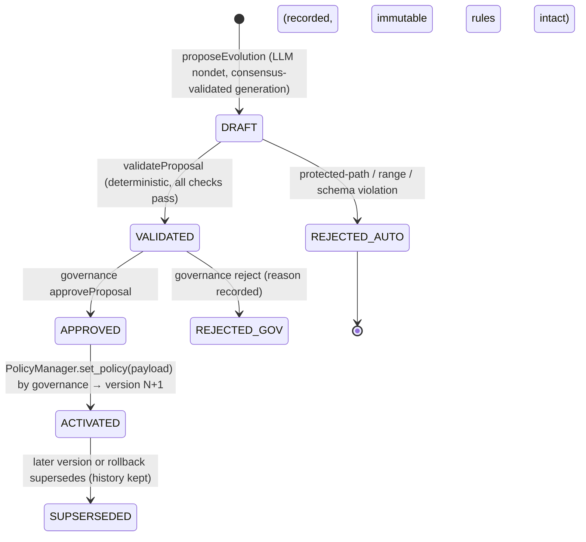

# GENESIS GUARDIAN — Lifeform Evolution Engine (Self-Evolution Design)

**Phase:** 1 design · **Build target:** Phase 3
**Principle:** *AI proposes. Rules constrain. Governance decides. History remembers.*

The Lifeform Engine evolves **security policy data** — never executable code, never roles,
never safety rules. Unrestricted self-modification is explicitly rejected by the project's
security requirements.

---

## 1. What Can Evolve vs What Never Can

| Evolves (via versioned policy) | Never evolves (Tier 1 immutable) |
|---|---|
| Evidence requirements per threat category | Emergency-gate logic (G1–G11) |
| Confidence thresholds (within safe floors) | Protected policy paths (see SECURITY_MODEL §1) |
| Corroboration minimums (within safe floors) | Recovery mechanism existence |
| Allowed actions per category (within policy envelope) | Rollback mechanism |
| Cooldowns, caps, auto_recovery toggles | Validator/equivalence requirements |
| Operational pacing parameters | Governance role definitions · contract code |
| False-positive remediation rules | Evidence taxonomy · idempotency rules · finality gating |

Floors are hard-coded: e.g., `min_confidence` can be *raised* but a proposal setting it below
the coded floor, or setting `allowed_threat_levels` to exclude HIGH while granting broad
actions, is rejected by structural validation (value-range checks, not just key names).

---

## 2. Proposal Lifecycle & Schema

**Proposal fields (the required 12):**

| # | Field | Notes |
|---|---|---|
| 1 | proposal_id | deterministic key (incident_id + seq) — idempotent writes |
| 2 | source_type | `EVOLUTION` (or `EMERGENCY` in future) |
| 3 | incident_id | originating incident (or "—" for policy-tuning proposals) |
| 4 | trigger_reason | what failure/gap motivated the proposal |
| 5 | proposal_reasoning | AI rationale (stored, never trusted as logic) |
| 6 | current_policy | snapshot of active policy version JSON |
| 7 | proposed_policy | full proposed policy payload (validated as a whole) |
| 8 | changed_policy_fields | explicit list of changed keys (diff checked against payload) |
| 9 | safety_classification | `SAFE` / `REQUIRES_REVIEW` / `BLOCKED` — informational; **code recomputes the truth** in validation |
| 10 | proposed_by | `LIFEFORM_ENGINE` (AI-generated) — never an authority address |
| 11 | activation_status | DRAFT / VALIDATED / APPROVED / REJECTED_* / ACTIVATED |
| 12 | proposal_result | outcome detail + activation/rollback references |

---

## 3. Generation (nondet, equivalence-validated)

`proposeEvolution(incident_id)` — same pattern as `ThreatAnalyzer.assess`:

1. **Deterministic prelude:** snapshot incident + assessment + history + active policy via `view()`; bound sizes.
2. **Nondet block** (`gl.vm.run_nondet_unsafe`): leader runs an LLM prompt containing the
   incident outcome (including false-positive/recovery records), current policy, and the
   protected-paths list *as reference* — instructing a candidate change-set JSON;
   validator independently re-runs and compares decision fields (changed keys, proposed
   values, classification, source_type). Parse/validate defensively; `[LLM_ERROR]` classes apply.
3. **Deterministic epilogue:** store as DRAFT with `safety_classification` **overwritten** by
   the code's own preliminary structural check (the AI's self-classification is advisory only).

## 4. Validation (deterministic, Tier 1 logic)

`validateProposal(proposal_id)` checks — all must pass → VALIDATED, else REJECTED_AUTO (reason recorded):

1. Schema: all 12 fields present, types/enums valid, sizes bounded.
2. `changed_policy_fields` exactly equals the computed diff between current_policy and proposed_policy
   (no hidden changes outside the declared diff).
3. Every changed key ∈ known policy keys; **no protected-path key touched** (frozen match set + hash).
4. Value ranges: floors/ceilings per key (confidence ≥ coded floor, counts ≥ coded floor,
   cooldowns within sane bounds, enums valid).
5. Coherence: `allowed_actions` for a category cannot include emergency actions unless
   corroboration/confidence floors for that category remain ≥ coded minima (a proposal that
   trades safety for power is rejected structurally).
6. Proposal cannot alter `recovery_requires_governance` to remove governance recovery in a way
   that leaves *no* recovery path (recovery existence is Tier 1).
7. Idempotent: re-validation of an already-VALIDATED proposal is a no-op.

**Phase 3 tests:** Scenario F (valid proposal passes → governance activates → policy version
increments → rollback works) and Scenario G (malicious proposal attempting to alter immutable
safety rules is REJECTED_AUTO, rules verified byte-identical afterward).

## 5. Activation & Rollback (governance hands only)

- Activation: governance inspects the VALIDATED proposal (dashboard view) and calls
  `SecurityPolicyManager.set_policy(proposed_policy)` — the **engine holds no policy write
  right whatsoever**; approval is a governance act against a pre-validated payload.
- Rollback: `SecurityPolicyManager.rollback(target_version)` creates a new version copying the
  old payload — instant undo, full history, no deletion.
- Recording: the proposal's `activation_status`/`proposal_result` are updated by governance
  calls so the incident history shows proposal → activation → result end-to-end.

## 6. Why This Is a "Lifeform" Without Being Dangerous

The system *does* genuinely evolve: its defensive posture changes in response to real incident
outcomes (false positives tighten corroboration; missed detections raise thresholds; novel
categories gain new evidence rules). What it cannot do — by construction, tested, and
documented — is rewrite the laws it must obey, grant itself authority, silence recovery, or
touch its own code. **AI proposes; governance disposes; immutable rules hold.**
