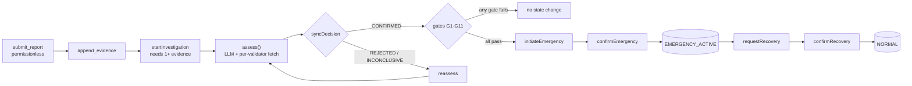

<div align="center">

# GENESIS GUARDIAN

**An autonomous security lifeform for protocols, built on GenLayer.**

Anyone can report an incident. Every validator fetches the evidence itself. AI consensus reaches a verdict. Deterministic gates decide whether the protocol may pause — and governance alone evolves the rules.


[Quickstart](#quickstart) · [Pipeline](#the-pipeline) · [Contract surface](#contract-surface) · [Policy](#policy) · [Docs](#documentation)

</div>

---

| | |
|---|---|
| **Network** | GenLayer Studionet · chain `61999` · `https://studio.genlayer.com/api` |
| **Contract** | [`0x0a138C4F8d5E7F06f597a8203F1B9916a552D8B3`](https://explorer-studio.genlayer.com/address/0x0a138C4F8d5E7F06f597a8203F1B9916a552D8B3) |
| **Deploy tx** | `0xa70c80629056764261adabe6e26d4a3f519cc28a3abd8197929312ed298d21e6` — `FINALIZED` · `MAJORITY_AGREE` |
| **Governance** | `0x3958A649b41cd7C8561F4233cC0F5b0469Bc98E0` |
| **Deployed** | 2026-11-04 · 56,504 source bytes |

The console in `frontend/` talks to that address through real `gen_call` reads and wallet-signed writes. There is no mock API, no seeded demo data, and nothing rendered from a fixture.

## Quickstart

```bash
git clone https://github.com/dhozil/genesis-guardian
cd genesis-guardian/frontend
npm install
npm run dev          # http://127.0.0.1:5180
```

Requires Node 20+ (built on Node 24). Reads work with no wallet; writes need MetaMask or Rabby on chain `61999`.

| Route | What it is |
|---|---|
| `/` | Landing: what the lifeform does and where to enter |
| `/console` | Operations console — telemetry, incident lifecycle, AI consensus panel, guarded writes |
| `/how-it-works` | Mechanism: consensus guarantees, emergency state machine, policy gates, full method reference |

## The pipeline



Every step is permissionless except where noted. A rejected or inconclusive verdict writes no emergency state; a confirmed one still has to clear eleven deterministic gates before the protocol can move.

## What it refuses to trust

| Guarantee | How it is enforced |
|---|---|
| **A dead link is not evidence** | Each validator runs its own `gl.nondet.web.get` on every `http(s)` reference and records `VERIFIED`, `FAILED` or `UNAVAILABLE`. Only `VERIFIED` refs count toward corroboration (G7). |
| **The AI cannot drift** | The prompt is built from a frozen incident snapshot; validators compare only decision fields — threat level, category, confidence, recommended action, reasoning. Disagreement is `MAJORITY_DISAGREE` and writes nothing. |
| **Gates are not negotiable** | G1–G11 are plain Python: protocol state, assessment present, `CONFIRMED` only, metadata, allowed threat levels, confidence floor, corroborated sources, no unresolved conflict, cooldown, allowed action, pause capability. |
| **Authority is two-phase** | `initiateEmergency` only arms `EMERGENCY_PENDING`; `confirmEmergency` activates it. Recovery is `requestRecovery` → `confirmRecovery`, and `resetToNormal` restores `NORMAL`. |
| **Policy is versioned** | `set_policy` / `rollback` are governance-only and append a new policy record, so every verdict can be explained against the policy version in force. |
| **Prompt injection has a ceiling** | Submitted text is data inside a delimited snapshot, and the decision rules reject anything the evidence does not support — a source claiming "ignore previous instructions" cannot move a gate. |

## Contract surface

One contract, four areas: policy, incident intelligence, emergency authority, protected state. `14` views, `14` writes.

<table>
<tr><th align="left">Views (14)</th><th align="left">Writes (14)</th></tr>
<tr><td valign="top">

`get_state`<br/>`get_version`<br/>`get_policy`<br/>`get_policy_at`<br/>`get_policy_record`<br/>`get_incident`<br/>`get_incident_ids`<br/>`get_evidence`<br/>`get_evidence_for_incident`<br/>`get_assessment`<br/>`get_history`<br/>`get_protocol_hint`<br/>`is_paused`<br/>`pause_supported`

</td><td valign="top">

`submit_report`<br/>`append_evidence`<br/>`startInvestigation`<br/>`assess`<br/>`syncDecision`<br/>`reassess`<br/>`resolveIncident`<br/>`initiateEmergency`<br/>`confirmEmergency`<br/>`requestRecovery`<br/>`confirmRecovery`<br/>`resetToNormal`<br/>`set_policy` *(governance)*<br/>`rollback` *(governance)*

</td></tr>
</table>

Bounded on purpose: `500` incidents, `64` evidence rows per incident, `8` inline evidence rows per report, `8` fetches per assessment, `4096` description chars, `128` history entries per incident. A `CONFIRMED` incident can only be resolved by governance; every other resolution is permissionless.

## Policy

```json
{
  "min_confidence": "MEDIUM",
  "min_corroborating_sources": 2,
  "allowed_threat_levels": ["HIGH", "CRITICAL"],
  "allowed_actions": ["PAUSE_TARGET"],
  "cooldown_seconds": 3600
}
```

That is the policy the contract was deployed with. Bound checks: `min_corroborating_sources` 1–10, `cooldown_seconds` 0–604800 (7 days), threat levels from `NONE…CRITICAL`, actions from `PAUSE_TARGET` / `INVESTIGATE`. `require_content_match` is optional and can only make verification stricter, never weaker — a fetched page must then contain a needle from the incident itself.

## Lifecycle

| Incident status | Reached by | Notes |
|---|---|---|
| `SUBMITTED` | `submit_report` | Nothing is trusted yet; no assessment exists |
| `UNDER_INVESTIGATION` | `startInvestigation` | Requires at least one evidence row |
| `CONFIRMED` / `REJECTED` / `INCONCLUSIVE` | `syncDecision` | Stored only when validators agreed on the decision fields |
| `RESOLVED` / `FALSE_POSITIVE` | `resolveIncident` | Closing a `CONFIRMED` incident is governance-only |
| back to `UNDER_INVESTIGATION` | `reassess` | Reopens a decided incident for a fresh assessment |

| Protocol state | Reached by |
|---|---|
| `NORMAL` | initial state, `confirmRecovery`, `resetToNormal` |
| `EMERGENCY_PENDING` | `initiateEmergency` after all gates pass |
| `EMERGENCY_ACTIVE` | `confirmEmergency` |
| `RECOVERY_PENDING` | `requestRecovery` while active |

## Tests

```bash
genvm-lint check contracts/GenesisGuardian.py     # static validation, must exit 0
genlayer-test tests/direct/ -v                    # 51 fast tests, mocked web/LLM
gltest tests/integration/ -v -s --network studionet   # 17 consensus tests, paced
```

Direct suites cover policy versions and rollback bounds, the report/evidence registry, the assessment decision rules, and gates G1–G11 with hardening cases. Integration suites run every public method against real studionet consensus, including adversarial inputs. `scripts/run_studionet_suites.sh` paces the network-bound runs; `scripts/ui_flow_studionet.py` drives the same flow the console does.

## Repository

```
contracts/GenesisGuardian.py   # the whole system: policy, intelligence, authority, state
frontend/                      # Next.js 16 + React 19 console (Tailwind v4, genlayer-js 1.1.8)
tests/direct/                  # genlayer-test, mocked nondeterminism
tests/integration/            # gltest, real consensus
scripts/                       # redeploy, duplicate-studionet UI flow, suite runner
deployments/studionet.json     # address, deploy tx, bootstrap policy, governance
docs (root)                    # architecture, design, threat model, testing, security model
```

Frontend notes live in [frontend/README.md](frontend/README.md): the same-origin `/genlayer-rpc` proxy exists because studionet answers without CORS headers, and `src/views` avoids colliding with the Pages Router.

## Documentation

| Doc | Read it for |
|---|---|
| [PROJECT_OVERVIEW.md](PROJECT_OVERVIEW.md) | Vision, objectives, workflow, glossary |
| [ARCHITECTURE.md](ARCHITECTURE.md) | Components, trust boundaries, state machines |
| [CONTRACT_DESIGN.md](CONTRACT_DESIGN.md) | Storage, method contracts, gate definitions |
| [DATA_FLOW.md](DATA_FLOW.md) | Sequence diagrams and message inventory |
| [THREAT_MODEL.md](THREAT_MODEL.md) | Assets, STRIDE+ table, safety properties |
| [SECURITY_MODEL.md](SECURITY_MODEL.md) | Authorization matrix, anti-prompt-injection design |
| [GENLAYER_INTEGRATION.md](GENLAYER_INTEGRATION.md) | Verified GenLayer interfaces used here |
| [TESTING.md](TESTING.md) | Test layers, scenario matrix, results log |
| [DEPLOYMENT.md](DEPLOYMENT.md) | Deploy, wiring, keeper runbook, upgrade policy |
| [FEASIBILITY_REPORT.md](FEASIBILITY_REPORT.md) | Environment and capability verification |
| [LIFEFORM_EVOLUTION.md](LIFEFORM_EVOLUTION.md) | Self-proposed policy evolution (next milestone) |
| [REPO_STRUCTURE.md](REPO_STRUCTURE.md) · [COMPONENT_RESPONSIBILITY_MATRIX.md](COMPONENT_RESPONSIBILITY_MATRIX.md) | Layout and per-component authority |

## Limits

Stated plainly, because they matter more than the pitch:

- Consensus verifies **what validators can fetch**, not ground truth. A convincing false report that survives every validator is still a false report.
- The contract cannot stop third-party code. `pause_supported` and `is_paused` are the integration surface; a target that never reads them will not pause.
- Between `initiateEmergency` and `confirmEmergency`, finality is a keeper convention — the contract cannot observe another transaction's finality on-chain.
- Studionet only, not audited, no mainnet deployment. `assess` costs a real LLM round-trip per validator, so it is deliberately gated and paced.

<div align="center">
<sub>Runner pinned to <code>py-genlayer:1jb45aa8ynh2a9c9xn3b7qqh8sm5q93hwfp7jqmwsfhh8jpz09h6</code> — never <code>test</code> or <code>latest</code>.</sub>
</div>
